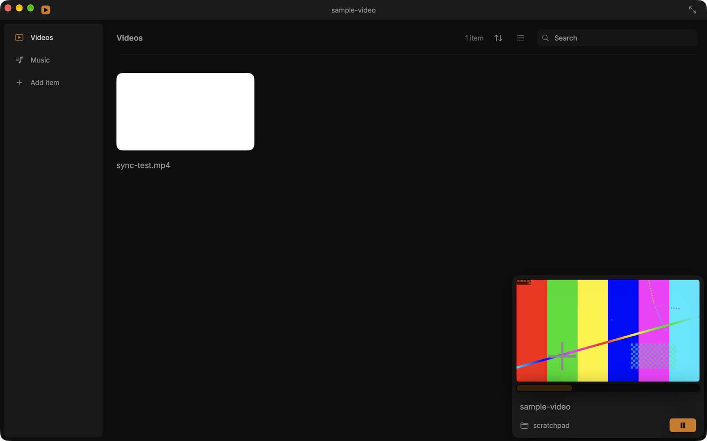
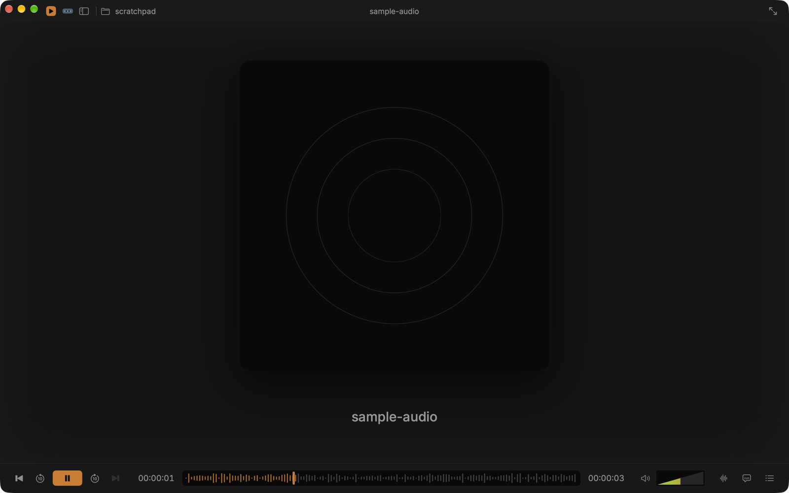
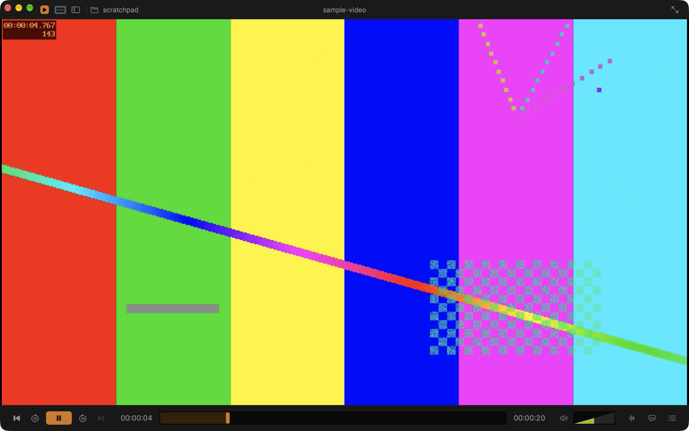
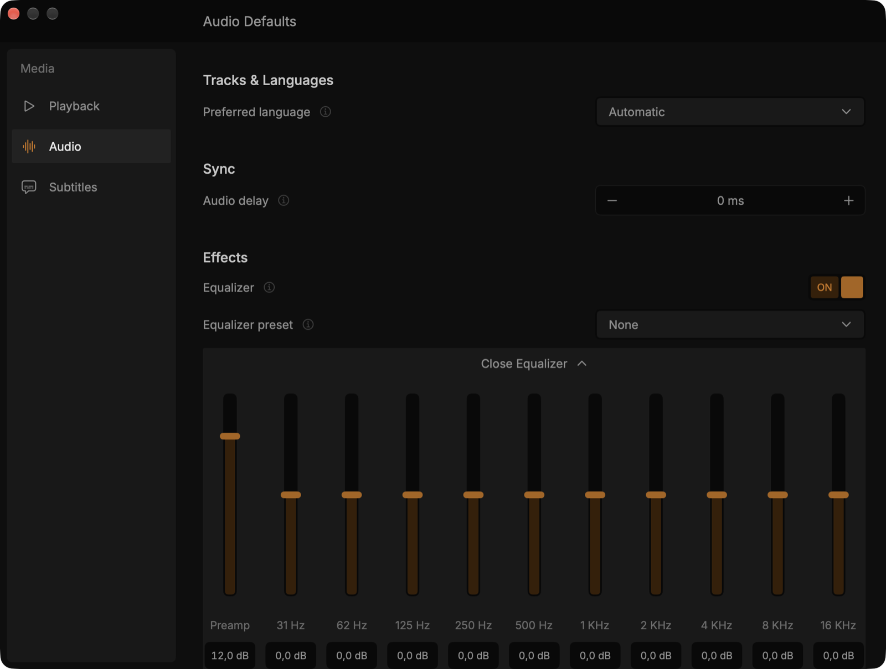

# Cone Player

A redesigned media player for macOS: VLC's playback engine with a SwiftUI interface built to the [VLC Redesign (Community)](https://www.figma.com/design/RS3geALGlV2J0HCIo5hK5N/VLC-Redesign--Community-) Figma file.

Cone Player is an independent project. It is not affiliated with or endorsed by VideoLAN. "VLC" is a trademark of VideoLAN.

## Screenshots



| Music | Video |
| --- | --- |
|  |  |



## What works today

- Plays any video or audio file VLC can play (File › Open, drag and drop, or Open With in Finder)
- Network streams: File › Open Network Stream… (⌘N) for http(s), HLS, rtsp, rtmp, udp, srt and more; the Network section lists recent streams
- Home: Continue Watching, Recently Added and your playlists at a glance
- Library of videos and music from `~/Movies` and `~/Music`, browsable by folder with a breadcrumb and back/forward, as a grid or list, with Quick Look thumbnails, sorting and search
- Resume playback: remembers where you stopped, offers "You've watched till …" (or resumes automatically, per Settings), and shows progress bars and dimmed names for watched files
- Recent: everything you've played, newest first, including files outside Movies/Music (kept reachable with security-scoped bookmarks)
- Playlists: create, rename and delete; add files from the right-click menu; Play All plays the playlist in order
- Floating miniplayer over the library with a live video preview
- Player screens from the Figma: video, and "Player – Music" with blurred artwork and waveform progress bar
- Control bar: previous/next through the library list, ±10s, play/pause, seek, VLC's 0–200% wedge volume, audio track and subtitle menus, queue
- Settings (⌘,): continue where you left off (Ask/Always/Never), playback speed, jump interval, auto-play next, audio and subtitle delay, subtitle size, preferred audio/subtitle language, and VLC's 10-band equalizer with presets
- Keyboard: Space play/pause, ⌘← / ⌘→ jump 10s, ⌥⌘← / ⌥⌘→ previous/next, ⌘1 Library, ⌘2 Player, ⌘[ / ⌘] back/forward, ⌘F search, ⌘N open stream, ⌘. stop

Planned next: more Settings panes (video, interface, network), local network discovery, Light theme.

## Design notes

Colors, sizes and typography come from the Figma file via its API; the tokens live in [`Theme.swift`](ConePlayer/Sources/Theme.swift). Where the Figma follows Windows conventions, the app follows macOS instead:

- Window controls are the standard traffic lights on the left.
- The Figma's "…" app menu is the macOS menu bar.
- Icons are SF Symbols that match the Figma's line icons.
- The app mark is an orange play glyph, not VLC's cone.

## Building

Requirements: macOS 15+, Xcode 26+, [XcodeGen](https://github.com/yonaskolb/XcodeGen) (`brew install xcodegen`).

```bash
xcodegen generate
open ConePlayer.xcodeproj
```

Then run the **ConePlayer** scheme. The Xcode project is generated from `project.yml`, so edit that rather than the project file.

The app signs with an Apple Development certificate from team `2C39YHVFA2` (set in `project.yml`). A stable signature lets macOS remember the Movies/Music permission between builds. To build under another team, change `DEVELOPMENT_TEAM`.

### Notes

- Playback uses [VLCKit](https://code.videolan.org/videolan/VLCKit) 4.0.0-a25 via Swift Package Manager. VLCKit 4 is still pre-release.
- Video uses VLC's `samplebufferdisplay` output (AVSampleBufferDisplayLayer). The default OpenGL output crashes on current macOS with this VLCKit build.
- The music waveform is decorative; it doesn't come from the audio.

## License

Cone Player is licensed under the GNU GPL v3 or later (see [LICENSE](LICENSE)). VLCKit is licensed under the LGPL v2.1 or later. The bundled [Inter](https://rsms.me/inter/) font is licensed under the SIL Open Font License 1.1 (see `ConePlayer/Resources/Fonts/Inter-LICENSE.txt`).
