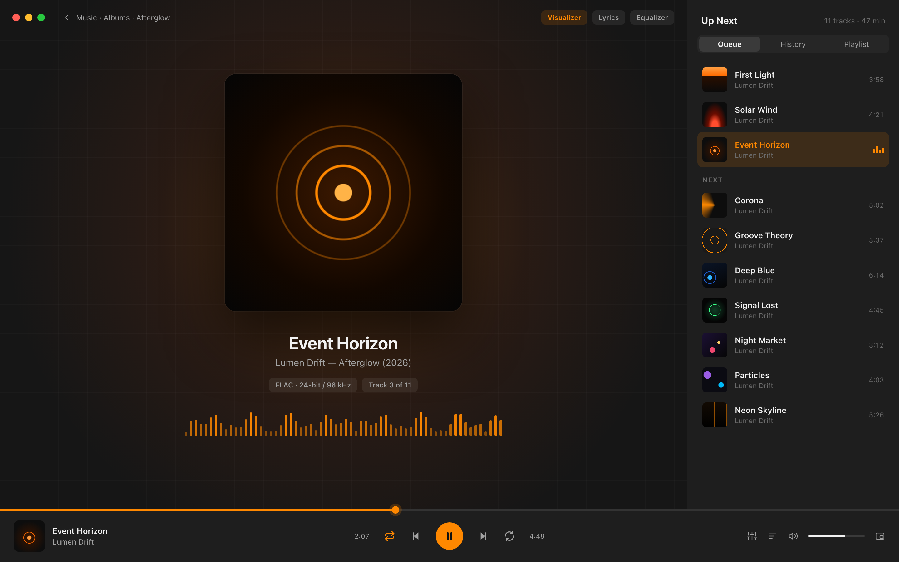

# Cone Player

A redesigned media player for macOS: VLC's playback engine with a modern SwiftUI interface, based on the [VLC Redesign (Community)](https://www.figma.com/design/RS3geALGlV2J0HCIo5hK5N/VLC-Redesign--Community-) Figma file.

Cone Player is an independent project. It is not affiliated with or endorsed by VideoLAN. "VLC" is a trademark of VideoLAN.

## Design

| Library | Now Playing |
| --- | --- |
|  |  |

The images are rendered from the HTML mockups in [`docs/mockups/`](docs/mockups). To re-render them after editing:

```bash
for n in library now-playing; do
  "/Applications/Google Chrome.app/Contents/MacOS/Google Chrome" --headless=new --hide-scrollbars \
    --force-device-scale-factor=2 --window-size=1440,900 \
    --screenshot="$PWD/docs/images/$n.png" "file://$PWD/docs/mockups/$n.html"
done
```

## What works today

- Plays any video or audio file VLC can play (File › Open, drag and drop, or Open With in Finder)
- Library of videos and music found in `~/Movies` and `~/Music`, with search
- Now Playing view: video surface, or artwork view for audio
- Bottom control bar: seek, ±10s, play/pause, volume
- Keyboard: Space play/pause, ⌘← / ⌘→ jump 10s, ⌘. stop

Planned next: Settings (EQ, subtitles, audio), Miniplayer, playlists and queue, network streams, subtitle and audio track menus, real thumbnails.

## Building

Requirements: macOS 15+, Xcode 26+, [XcodeGen](https://github.com/yonaskolb/XcodeGen) (`brew install xcodegen`).

```bash
xcodegen generate
open ConePlayer.xcodeproj
```

Then run the **ConePlayer** scheme. The Xcode project is generated from `project.yml`, so edit that rather than the project file.

### Notes

- Playback uses [VLCKit](https://code.videolan.org/videolan/VLCKit) 4.0.0-a25 via Swift Package Manager. VLCKit 4 is still pre-release.
- Video uses VLC's `samplebufferdisplay` output (AVSampleBufferDisplayLayer). The default OpenGL output crashes on current macOS with this VLCKit build.

## License

Cone Player is licensed under the GNU GPL v3 or later (see [LICENSE](LICENSE)). VLCKit is licensed under the LGPL v2.1 or later.
